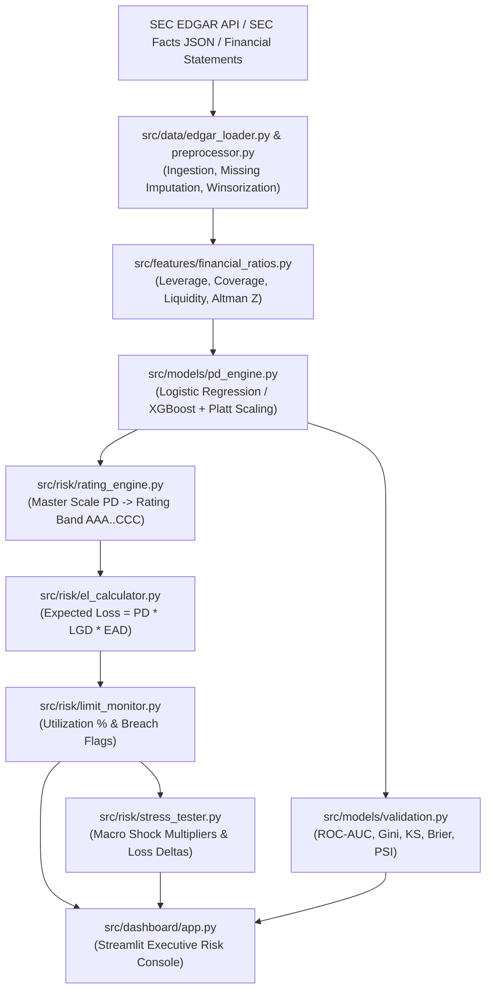

# GLOBAL CORPORATE COUNTERPARTY RATING & LIMIT MONITORING ENGINE (GCCR)
## System Design Specification (DESIGN.md)

### 1. Directory & File Structure
```
gccr_engine/
│
├── config/
│   ├── model_config.yaml          # Model hyperparameters, feature list, PSI bin counts
│   ├── rating_bands.yaml          # Master scale PD thresholds & rating labels
│   └── stress_scenarios.yaml      # Macro scenario multiplier matrices by sector
│
├── data/
│   ├── raw/
│   │   ├── edgar_sec_financials.csv # Financial statement data from SEC filings
│   │   └── corporate_defaults.csv   # Historical corporate default flags
│   ├── processed/
│   │   ├── features_engineered.parquet
│   │   └── model_predictions.parquet
│   └── portfolio/
│       └── exposures_limits.csv     # Exposure at Default (EAD), LGD, and Credit Limits
│
├── docs/
│   ├── PRD.md
│   └── DESIGN.md
│
├── notebooks/
│   ├── 01_sec_edgar_data_cleaning.ipynb
│   ├── 02_pd_model_training_calibration.ipynb
│   └── 03_rmg_validation_and_stress_testing.ipynb
│
├── src/
│   ├── __init__.py
│   ├── data/
│   │   ├── __init__.py
│   │   ├── edgar_loader.py         # SEC EDGAR API & Kaggle dataset ingestion
│   │   └── preprocessor.py         # Outlier winsorization, missing value imputation
│   │
│   ├── features/
│   │   ├── __init__.py
│   │   └── financial_ratios.py     # Solvency, Liquidity, & Altman Z Ratio Engine
│   │
│   ├── models/
│   │   ├── __init__.py
│   │   ├── pd_engine.py            # Logistic & XGBoost training + Platt Calibration
│   │   └── validation.py           # ROC-AUC, Gini, KS, Brier, PSI validation suite
│   │
│   ├── risk/
│   │   ├── __init__.py
│   │   ├── rating_engine.py        # Master scale PD-to-Rating mapping
│   │   ├── el_calculator.py        # Portfolio Expected Loss aggregation
│   │   ├── limit_monitor.py        # Limit utilization & breach flag generation
│   │   └── stress_tester.py        # Sector-level macro scenario stress testing
│   │
│   └── dashboard/
│       ├── __init__.py
│       └── app.py                  # Streamlit Executive Dashboard
│
├── tests/
│   ├── test_ratios.py              # Unit tests for fundamental ratios
│   ├── test_pd_engine.py           # Unit tests for Platt calibration
│   ├── test_limit_monitor.py       # Unit tests for limit breach detection
│   └── test_stress_tester.py       # Unit tests for macro stress deltas
│
├── .gitignore
├── README.md
├── requirements.txt
└── run_pipeline.py                 # CLI entry point executing full engine
```

---

### 2. High-Level Data Flow Architecture


---

### 3. Quantitative Formulations

#### A. Financial Ratio Engine Formulations
- **Interest Coverage Ratio (ICR)**:
  $$\text{ICR} = \frac{\text{EBIT}}{\max(|\text{Interest Expense}|, 10^{-5})}$$
- **Leverage Ratio**:
  $$\text{Debt-to-EBITDA} = \frac{\text{Total Debt}}{\max(\text{EBITDA}, 10^{-5})}$$
- **Current Liquidity Ratio**:
  $$\text{Current Ratio} = \frac{\text{Current Assets}}{\max(\text{Current Liabilities}, 10^{-5})}$$
- **Operating Cash Flow Ratio**:
  $$\text{OCF-to-Debt} = \frac{\text{Operating Cash Flow}}{\max(\text{Total Debt}, 10^{-5})}$$
- **Operating Profit Margin**:
  $$\text{Operating Margin} = \frac{\text{EBIT}}{\max(\text{Revenue}, 10^{-5})}$$
- **Altman Z-Score Model (Corporate Manufacturing & General Firms)**:
  $$Z = 1.2 X_1 + 1.4 X_2 + 3.3 X_3 + 0.6 X_4 + 0.999 X_5$$
  where:
  - $X_1 = (\text{Current Assets} - \text{Current Liabilities}) / \text{Total Assets}$
  - $X_2 = \text{Retained Earnings} / \text{Total Assets}$
  - $X_3 = \text{EBIT} / \text{Total Assets}$
  - $X_4 = \text{Market Cap} / \text{Total Liabilities}$
  - $X_5 = \text{Revenue} / \text{Total Assets}$

#### B. Probability of Default (PD) Scorecard Calibration
- **Logistic Regression Scorecard**:
  $$z_i = \beta_0 + \sum_{j=1}^{K} \beta_j X_{ij}, \quad \hat{p}_i = \frac{1}{1 + e^{-z_i}}$$
- **Platt Scaling Calibration**:
  $$PD_i = \frac{1}{1 + \exp(-(A \cdot z_i + B))}$$
  where parameters $A$ and $B$ are estimated using maximum likelihood on out-of-fold calibration data.

#### C. RMG Validation Metrics
- **Gini Coefficient**:
  $$\text{Gini} = 2 \times \text{AUC} - 1$$
- **Kolmogorov-Smirnov (KS) Statistic**:
  $$KS = \max_t |F_{\text{Default}}(t) - F_{\text{Non-Default}}(t)| \times 100\%$$
- **Brier Score (BS)**:
  $$BS = \frac{1}{N} \sum_{i=1}^N (PD_i - y_i)^2$$
- **Population Stability Index (PSI)**:
  $$PSI = \sum_{b=1}^B (\text{Actual}_b - \text{Expected}_b) \times \ln\left(\frac{\text{Actual}_b}{\text{Expected}_b}\right)$$

#### D. Exposure Analytics & Stress Testing Formulations
- **Counterparty Expected Loss**:
  $$EL_i = PD_i \times LGD_i \times EAD_i$$
- **Credit Limit Utilization (%)**:
  $$\text{Utilization}_i = \left(\frac{EAD_i}{\text{Credit Limit}_i}\right) \times 100$$
- **Macroeconomic PD Shift Under Stress Scenario $S$**:
  $$PD_{i,\text{stressed}} = \min(1.0, PD_{i,\text{baseline}} \times \text{Multiplier}_{S,\text{Sector}})$$
  $$LGD_{i,\text{stressed}} = \min(1.0, LGD_{i,\text{baseline}} + \Delta LGD_S)$$
  $$EL_{i,\text{stressed}} = PD_{i,\text{stressed}} \times LGD_{i,\text{stressed}} \times EAD_i$$

---

### 4. Data Schemas

#### Schema 1: raw/edgar_sec_financials.csv
- `cik`: SEC Central Index Key (10-digit zero padded or standard string)
- `company_name`: Official legal entity corporate name
- `sector`: GICS/Standard Industry Sector (Technology, Industrials, Consumer Goods, Energy, Healthcare, Telecom, Utilities, Basic Materials)
- `fiscal_year`: Fiscal filing year (YYYY)
- `total_assets`: Total assets in USD ($M)
- `total_liabilities`: Total balance sheet liabilities in USD ($M)
- `current_assets`: Current assets in USD ($M)
- `current_liab`: Current liabilities in USD ($M)
- `total_debt`: Short-term and long-term interest bearing debt in USD ($M)
- `revenue`: Top-line gross revenue in USD ($M)
- `ebit`: Operating income / EBIT in USD ($M)
- `ebitda`: EBITDA in USD ($M)
- `interest_exp`: Annual interest obligations in USD ($M)
- `operating_cf`: Operating cash flow in USD ($M)
- `retained_earning`: Cumulative retained earnings in USD ($M)
- `market_cap`: Equity market capitalization in USD ($M)

#### Schema 2: portfolio/exposures_limits.csv
- `cik`: CIK Foreign Key
- `ead`: Exposure at Default in USD ($M)
- `lgd`: Downturn Loss Given Default (0.0 to 1.0)
- `credit_limit`: Board/Credit Committee Approved Facility Limit in USD ($M)

---

### 5. RMG Performance Targets

| Metric Class | Target | Alarm Trigger |
| :--- | :--- | :--- |
| **ROC-AUC** | $\ge 0.80$ | $< 0.72$ |
| **Gini** | $\ge 0.60$ | $< 0.44$ |
| **KS Stat** | $\ge 45.0\%$ | $< 35.0\%$ |
| **Brier Score** | $\le 0.08$ | $> 0.15$ |
| **PSI** | $< 0.10$ | $> 0.25$ |
